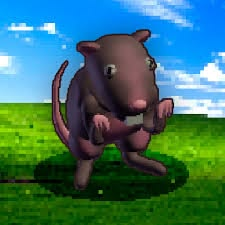

<!DOCTYPE html>
<html lang="es">
<head>
  <meta charset="UTF-8">
  <meta name="viewport" content="width=device-width, initial-scale=1.0">
  <title> Los Ratatines</title>
 
  <link rel="stylesheet" href="Estilocss.css">
</head>
<body>

  <h1>Los roedores</h1>
  
Los roedores son de los mamiferos mas lindo y pequeños en el planeta

  <section>
    <h2>¿Qué son los ratones y por qué los elegí?</h2>
    
Los ratones son pequeños mamíferos roedores estos pequeños seres son conocidos por su agilidad, adaptacion a distintos entornos , flexibilidad y por ser bonitos 

    
Elegí este tema porque me parece que estos animales son mas que una plaga, ellos son utiles para este mundo apesar de que mucha gente no conoce su importancia

    
Los ratones y los roedores son importantes en mi vida por que me identifico mucho con ellos

  </section>

  

  <section>
    <h2>Características</h2>
    <ul>
      <li>Son mamiferos con tamaños y estructiras muy diversas</li>
      <li>Poseen un olfato y un oido muy desarrollado</li>
      <li>Pueden acoplarse a cuarquier tipo de flora y fauna</li>
      <li>Tienen una excelente memoria y son sumamente inteligentes</li>
      <li>Son animales de hábitos nocturnos y silenciosos en su mayoria</li>
    </section>
    </ul>
    
    <h2>Nombres de Roedores populares</h2>
    <ol>
      <li>Raton/Rata</li>
      <li>Ardilla</li>
      <li>Chinchilla</li>
      <li>hamster</li>
      <li>Topo</li></li>
    </ol>
  
    <h2>Enlaces de interes</h2>
    

      <a href="https://www.nationalgeographic.com.es/animales/roedores target=" target="_blank">Roedores </a>  
      <a href="https://siiaec.sma.gob.mx/docs/mamiferos-roedores/target_blank" target="_black">Mas informacion sobre los roedores</a>  
      <a href="https://www.revista.unam.mx/2024v25n5/los_roedores_animales_fantasticos_y_donde_encontrarlos/" target="_black">Aun mas informacion sobre los roedores</a>  
    

      
    <section>
   <h2>¿Sabias que...?</h2>
      
Sus dientes incisivos crecen hasta 12 centímetros al año

      
Pueden masticar materiales duros como madera, plomo, aluminio y concreto

    </section>
      
    <section>
      <h2>Opinion personal:</h2>
      
Esos pequeños amigos deberian de ser mas apreciados, pueden ser como un animal domestico cualquiera aunque con una exigencia mas elevada pero ellos puedem ser tu mejor amigo<3

        
Al investigar de estos animales tan curiosos me pude dar cuenta de su importancia y lo importante que pueden llegar a ser

    </section>
      
      <footer>
        
Alejandro Ayala Espinosa

        
5°B

        
2026

        
"Hasta a la mejor cocinera se le queman los frijoles"

      </footer>
      
</body>
</html>
